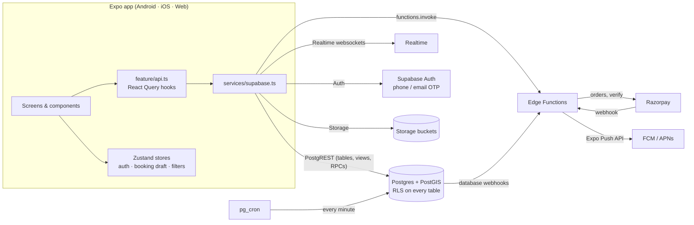

# Architecture

## The big picture



There is **no custom backend server**. Business rules that must be trustworthy, such as pricing, availability, matching and status transitions, live in Postgres functions guarded by Row Level Security. The only server code is four small Edge Functions, and they exist only because they need secrets (the Razorpay key, the service role key).

## Layers and rules

| Layer | Lives in | Rule |
| --- | --- | --- |
| Screens | `src/features/*/screens` | Compose components, read hooks, navigate. **Never import `supabase` directly.** |
| Feature components | `src/features/*/components` | UI used by one feature only |
| Data hooks | `src/features/*/api.ts` | The only place that talks to Supabase. Exports `fetchX`, `xQueryOptions`, `useX` |
| Shared UI | `src/components` | Generic, theme-driven building blocks. No data fetching |
| Client state | `src/store` | Zustand. Only state that isn't on the server |
| Services | `src/services` | Singletons: Supabase client, QueryClient + key factory, env validation, places, storage, push |
| Theme | `src/theme` | Colour, type and spacing tokens. No raw hex values in components |

### Server state vs client state

This is the most important convention in the codebase:

- **Anything that lives in the database goes through React Query.** That includes vendors, bookings, messages and earnings. React Query handles caching, loading and error states, refetch on focus, pagination and invalidation.
- **Zustand holds only what the server doesn't know:**
  - `authStore`: the session mirror, the profile, `vendorId`, and **`activeRole`**, which drives role switching
  - `bookingDraftStore`: the booking being assembled across several screens, before it exists in the database
  - `filtersStore`: browse filters and the user's chosen location, shared by Home and Search

If you're tempted to copy query data into a store, invalidate the query instead.

### Query keys

All keys come from the factory `qk` in [src/services/queryClient.ts](../src/services/queryClient.ts), for example `qk.vendors.top(filters)` or `qk.bookings.detail(id)`. Hierarchical keys make invalidation predictable: `invalidateQueries({ queryKey: qk.vendors.all })` refreshes every vendor list after a change.

### Errors

`unwrap()` (rows that must exist), `unwrapMaybe()` (`.maybeSingle()`) and `assertOk()` (writes) convert Supabase `{ data, error }` results into thrown errors, so every hook exposes a normal React Query `error`. Screens render `ErrorState` with a retry button. Postgres functions raise human-readable messages (e.g. "That time is no longer available"), which reach the UI unchanged.

### Realtime

`useRealtimeInvalidate()` subscribes to Postgres changes and **invalidates React Query keys**. It doesn't keep a parallel copy of the data. Tracking, chat and the vendor requests inbox therefore use the same data path as everything else, and RLS still filters what each user receives.

## Navigation and role switching

```
RootStack (native-stack)
├── CustomerTabs ─ Home · Explore · Bookings · Profile      ← when activeRole = 'customer'
│   or
├── VendorTabs   ─ Dashboard · Requests · Calendar · Catalog · Earnings   ← when activeRole = 'vendor'
├── SearchResults · VendorProfile · ServiceDetail            ← open to guests
├── [signed in] BookingDetails · AddressPicker · OrderReview · Payment · BookingConfirmation
│               BroadcastRequest · BroadcastWaiting · Tracking · Chat · RateReview
│               VendorSignup · VendorKyc · VendorSetup · VendorUnderReview · Portfolio · RequestDetail
└── [guest]     PhoneLogin · VerifyOtp (modal)
```

- **One app, two shells.** `RootNavigator` registers *either* `CustomerTabs` or `VendorTabs`. Flipping `authStore.activeRole` swaps the shell and React Navigation resets to the first tab. Vendor mode is only possible when the user owns a vendor row, and the store enforces this.
- **Guests browse first.** Home, search and vendor profiles need no account. Actions that need one call `useRequireAuth()`, which opens the sign-in modal. After sign-in, the auth screens drop out of the navigator automatically and the user is back where they were.
- **Every pushable screen is in the root stack**, so any screen can `navigation.navigate('X', params)` with full type checking ([src/types/navigation.ts](../src/types/navigation.ts)).

## Auth lifecycle

1. `useAuthListener()` (mounted once in `App.tsx`) reads the persisted session, loads `profiles` and the user's `vendors.id`, then marks the store `initialized`. The splash screen stays up until then.
2. On `SIGNED_IN` it reloads the profile and registers the device's push token.
3. On `SIGNED_OUT` it resets the store and clears the React Query cache, so no data leaks between accounts.

## Booking flow (data perspective)

```
VendorProfile ──▶ ServiceDetail ──▶ BookingDetails ──▶ OrderReview ──▶ Payment ──▶ Confirmation ──▶ Tracking
  useVendor*        startDirect()     get_available_slots   quote_booking     razorpay-*        useBooking (realtime)
                    (draft store)     addresses             create_booking ◀── the first server write
```

Nothing touches the server until **Order Review** calls `create_booking`. Before that, everything lives in `bookingDraftStore`. Abandoned flows leave no rows behind, and the server re-validates price, availability and service area atomically. See [MATCHING.md](MATCHING.md) for direct vs broadcast.

## Platform-specific code

Metro picks `file.web.ts` over `file.ts` on web. This is used for Razorpay (`razorpay.ts` uses the native SDK, `razorpay.web.ts` uses checkout.js). Follow the same pattern for maps when you build the tracking screen (`Map.tsx` / `Map.web.tsx`). `react-native-maps` must never be imported in code that runs on web.

## Security model in one paragraph

The app only ever holds the **anon key**. Every table has RLS. Customers see their own bookings, vendors see bookings assigned or offered to them, and the public sees only `live` vendors. Columns a user must not set themselves (`is_verified`, ratings, `role`, onboarding status beyond review) are protected by triggers. Bookings can only be created and moved through `security definer` RPCs that validate every transition. Payments are written only by Edge Functions holding the service role key, after verifying Razorpay's HMAC signature. KYC documents and chat photos live in private buckets readable only by the owner, the booking parties or admins.
