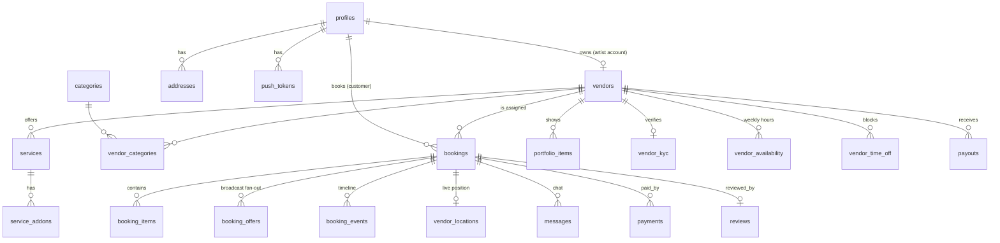

# Backend reference (Supabase)

Everything server-side is in [supabase/](../supabase):

```
supabase/
  config.toml                         CLI config (seed path, webhook JWT setting)
  migrations/
    20261014000000_init.sql           extensions, enums, tables, triggers, view, RLS, column guards
    20261014000100_booking_logic.sql  pricing, availability, booking + matching RPCs, search, admin, storage, realtime, cron
  seed.sql                            6 categories, 6 demo vendors with services, add-ons, portfolio
  tests/smoke_test.sql                end-to-end test in a rolled-back transaction
  functions/                          Deno Edge Functions
```

## Data model



| Table | Notes |
| --- | --- |
| `profiles` | 1:1 with `auth.users`, auto-created by trigger. `role`: customer / vendor / admin |
| `categories` | Makeup, Mehndi, Nails, Bridal, Salon, Hairstyling. `icon` is an Ionicons name |
| `vendors` | Artist or salon. `lat/lng` feed a generated PostGIS `location`. `status` moves draft → kyc_pending → under_review → live. `rating_*`, `completed_count` and `starting_price` are maintained by triggers |
| `services` | Each has `price_home` and/or `price_salon` (null = not offered). `is_package` + `includes[]` for bridal packages |
| `service_addons` | Optional extras with price and extra minutes |
| `vendor_kyc` | Paths into the private `kyc` bucket. `match_score` is reserved for an automated face-match provider |
| `vendor_availability` / `vendor_time_off` | Weekly hours (0 = Sunday) and blocked ranges |
| `addresses` | Customer addresses with coordinates |
| `bookings` | One row per appointment. `address` is a JSON snapshot. All money in whole ₹ |
| `booking_items` | Service + add-on line items (price snapshot) |
| `booking_offers` | Broadcast invitations, one per vendor |
| `booking_events` | Status timeline, written by trigger on every status change |
| `vendor_locations` | Latest artist position for a booking (realtime) |
| `messages` | Booking-scoped chat (realtime) |
| `payments` | Razorpay orders/payments, written only by Edge Functions |
| `reviews` | One per completed booking. `reviewer_name` is a first-name snapshot (profiles are private) |
| `payouts` | Payout ledger for vendors |
| `push_tokens` | Expo push tokens per device |
| `vendor_cards` (view) | Read model for list screens: vendor + category names/slugs |

## Functions (RPCs)

Called from the app with `supabase.rpc(name, args)`. Typed in [src/types/database.ts](../src/types/database.ts).

| Function | Who | What |
| --- | --- | --- |
| `search_vendors(...)` | anyone | Category / text / mode / price / verified / radius filters, sorting by rating, price or distance, paginated |
| `get_available_slots(vendor, date, minutes)` | anyone | Bookable 30-min start times (IST) |
| `quote_booking(service, mode, addons)` | anyone | Price breakdown: subtotal, add-ons, travel fee, platform fee, total, duration |
| `create_booking(...)` | signed in | Direct or broadcast booking (see [MATCHING.md](MATCHING.md)) |
| `respond_to_offer(offer, accept)` | vendor | Broadcast accept/decline. Returns `false` if another vendor won |
| `respond_to_booking(booking, accept)` | vendor | Direct request accept/decline |
| `advance_booking(booking, status)` | vendor | accepted → en_route → in_progress → completed (salon can skip en_route). Marks pay-at-service paid on completion |
| `cancel_booking(booking, reason)` | either party | Allowed while requested / broadcasting / accepted |
| `vendor_earnings_summary()` | vendor | Today's jobs, today/week/month earnings, pending payout |
| `admin_review_vendor(vendor, approve, notes)` | admin / SQL editor | Approve (live + verified) or reject after KYC |
| `expire_stale_bookings()` | pg_cron | Expires overdue broadcasts and unanswered direct requests |
| `my_vendor_id()`, `owns_vendor()`, `is_booking_party()`, `is_admin()` | internal | Helpers used by RLS |

## Row Level Security summary

| Data | Read | Write |
| --- | --- | --- |
| categories, services, add-ons, portfolio, reviews, availability | everyone | owner vendor (reviews: customer of a completed booking) |
| vendors | `live` ones to everyone, own row, admins | owner (guarded columns), admins |
| profiles | self, admins, vendors whose bookings you made | self (role is guarded) |
| addresses, favorites, push_tokens | owner | owner |
| bookings, items, events | customer, assigned vendor, vendors with a pending offer, admins | **RPCs only** |
| booking_offers | the invited vendor, admins | RPCs only |
| messages, vendor_locations | booking parties | booking parties (location: vendor only) |
| payments | booking parties | Edge Functions (service role) only |
| vendor_kyc | owner, admins | owner submits, admins review |
| payouts | owner vendor, admins | admins / SQL |

**Column guards** (triggers, because RLS can't compare old and new values):

- `profiles.role` can only be changed by admins.
- On `vendors`, `is_verified`, the rating fields, `completed_count` and `owner_id` are managed by the system, and vendors can only move their own status draft/kyc_pending/rejected → kyc_pending/under_review.

Internal functions that legitimately update guarded columns, such as the rating trigger and `advance_booking`, set a transaction-local `app.trusted` flag for that one statement.

## Storage buckets

| Bucket | Public | Path convention | Who can upload | Who can read |
| --- | --- | --- | --- | --- |
| `avatars` | yes | `<user_id>/…` | owner | anyone |
| `portfolio` | yes | `<user_id>/…` | owner | anyone |
| `reviews` | yes | `<user_id>/…` | owner | anyone |
| `kyc` | **no** | `<user_id>/…` | owner | owner, admins |
| `chat` | **no** | `<booking_id>/…` | booking parties | booking parties (signed URLs) |

Helpers: `uploadImage`, `publicUrl`, `signedUrl` in [src/services/storage.ts](../src/services/storage.ts).

## Realtime

Published tables: `bookings`, `booking_offers`, `booking_events`, `vendor_locations`, `messages`. RLS applies to realtime too, so each client only receives rows it may read. In the app, use `useRealtimeInvalidate()` (see [ARCHITECTURE.md](ARCHITECTURE.md#realtime)).

## Edge Functions

| Function | Auth | Secrets | Notes |
| --- | --- | --- | --- |
| `razorpay-create-order` | user JWT | `RAZORPAY_KEY_ID`, `RAZORPAY_KEY_SECRET` | Reads the amount from the booking, so clients can't change prices |
| `razorpay-verify-payment` | user JWT | `RAZORPAY_KEY_SECRET` | HMAC-SHA256 of `order_id\|payment_id`, constant-time compare |
| `razorpay-webhook` | Razorpay signature (JWT check off) | `RAZORPAY_WEBHOOK_SECRET` | payment.captured / failed, refund.processed |
| `send-push` | service role (database webhook) | — | Maps table events to notifications. Sends via `exp.host` in chunks of 100 |

Local testing of a function: `npx supabase functions serve send-push --env-file supabase/.env.local`.

## Changing the schema

1. Create a new migration: `npx supabase migration new <name>`. Never edit an applied migration on a live project.
2. Write SQL and keep RLS in mind. Every new table needs `enable row level security` and explicit policies.
3. `npm run db:push`, then `npm run db:types` to regenerate TypeScript types.
4. Extend `supabase/tests/smoke_test.sql` if you changed booking rules.

## Tested

The migrations, seed and smoke test were run against PostgreSQL 16 with Supabase-like roles and auth, storage and realtime schemas emulated (PostGIS distance functions stubbed with an equivalent haversine). Every assertion passes: RLS isolation, column guards, pricing maths, direct booking, double-booking rejection, the broadcast race (the second accept loses), the job lifecycle, rating trigger, review eligibility and broadcast expiry. Run the same file on your Supabase project after deploying (see [DEPLOYMENT.md](DEPLOYMENT.md#verify)).
