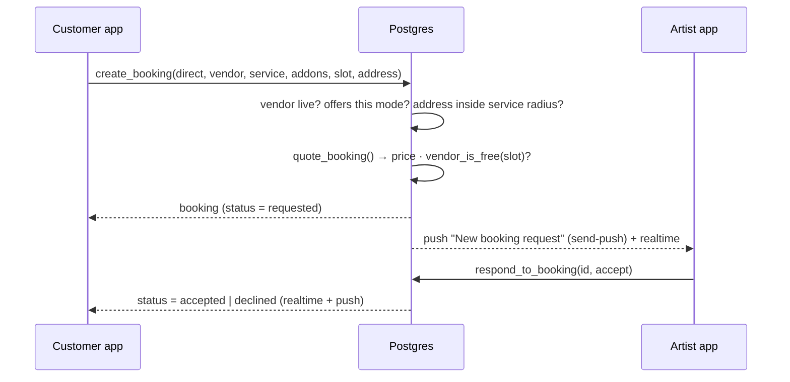
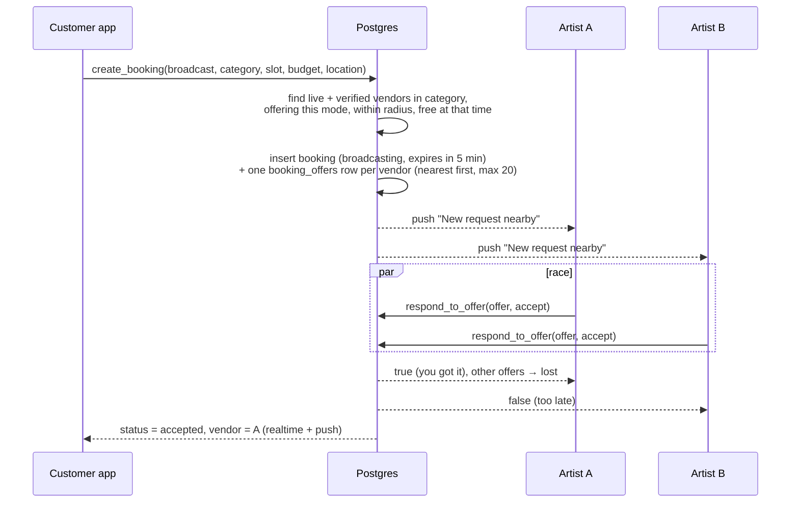

# Matching: direct and broadcast booking

Customers can get an artist in two ways. Both use the same `bookings` table and the same `create_booking()` function. The `p_match_type` argument decides which path runs.

| | **Direct** | **Broadcast** |
| --- | --- | --- |
| Customer picks | A specific artist and service | A category, time and budget |
| Price | From the artist's menu (`quote_booking`) | The customer's budget |
| Who gets the request | Only that artist | Every nearby verified artist in the category who is free |
| Starting status | `requested` | `broadcasting` |
| Who wins | The artist accepts or declines | **First artist to accept**, within a time window |
| If nobody answers | `expired` at the appointment time | `expired` when the window closes |

## Direct booking



Checks inside `create_booking` all run in one transaction:

- The vendor is `live` and offers the chosen mode (home/salon).
- The service belongs to that vendor and is active.
- For home visits, the address is within the vendor's `service_radius_km` (PostGIS distance).
- `vendor_is_free()`: no overlapping `requested/accepted/en_route/in_progress` booking and no time off.
- The price is recomputed server-side. The client never sends amounts.

Slots shown in the time picker come from `get_available_slots(vendor, date, duration)`. It returns 30-minute starts inside the vendor's weekly hours (09:00–20:00 IST if none are set), skips clashes and time off, and starts at least one hour from now.

## Broadcast booking



### Who receives the request

A vendor is offered the job only when **all** of these hold:

- `status = 'live'` **and** `is_verified = true`
- Linked to the requested category (`vendor_categories`)
- Offers the requested mode (`offers_home` / `offers_salon`)
- Has a location, and the distance from the customer is:
  - **home visit:** ≤ the vendor's own `service_radius_km` (how far they'll travel)
  - **salon visit:** ≤ `salon_search_radius_km` (how far the customer will travel, default 10 km)
- Is free at that time (`vendor_is_free`)
- Isn't the customer themselves

Up to `broadcast_max_vendors` (default 20) are invited, nearest first. If nobody qualifies, `create_booking` raises *"No verified artists are available near you…"* and no booking is created.

### How "first to accept wins" is guaranteed

`respond_to_offer` does:

```sql
update bookings
   set vendor_id = <this vendor>, status = 'accepted'
 where id = <booking> and status = 'broadcasting' and broadcast_expires_at > now()
returning id;
```

Postgres takes a row lock on the booking. If two vendors accept at the same instant, the second `UPDATE` waits for the first to commit. It then re-checks the `WHERE` clause, finds `status = 'accepted'`, updates nothing, and the function returns `false`. There are no application-level locks and no race window. The smoke test (`supabase/tests/smoke_test.sql`) exercises exactly this.

After a win, the winner's offer becomes `accepted` and every other pending offer becomes `lost`. The realtime subscription on `booking_offers` removes the card from the other artists' inboxes.

### Declines and expiry

- If every invited vendor **declines**, the broadcast ends immediately as `expired`.
- Otherwise `expire_stale_bookings()` runs **every minute via pg_cron**. It marks overdue broadcasts `expired` (and their pending offers `expired`), along with direct requests whose appointment time has passed unanswered.
- The customer's *Finding your artist…* screen counts down to `broadcast_expires_at` and reacts to the realtime status change.

## Tuning

All knobs live in `app_config()` at the top of `supabase/migrations/20261014000100_booking_logic.sql`:

| Key | Default | Meaning |
| --- | --- | --- |
| `broadcast_window_minutes` | 5 | How long artists have to accept |
| `broadcast_max_vendors` | 20 | Fan-out cap per request |
| `salon_search_radius_km` | 10 | Max customer travel for salon broadcasts |
| `home_travel_fee` | 99 | ₹ added to home visits |
| `platform_fee_pct` | 2 | % of service value kept by the platform |
| `min_lead_minutes` | 60 | Earliest bookable time from now |

Change a value, then re-run the `create or replace function public.app_config…` statement in the SQL Editor. No app release is needed.

## Ideas for later

- **Smarter ranking:** order offers by a score (distance, rating, acceptance rate) instead of distance alone, or send in waves (nearest 5, then the next 10 after 60 s).
- **Counter-offers:** let artists propose a different price for broadcast requests.
- **Auto-cancel unpaid:** if `payment_method = 'online'`, cancel accepted bookings that aren't paid within N minutes.
